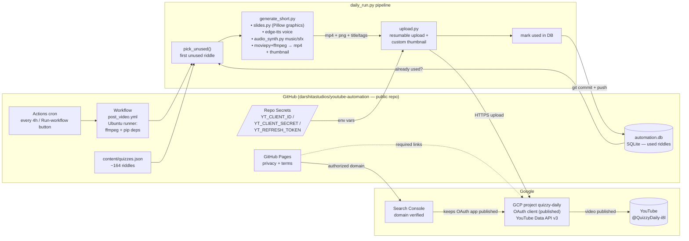

# Architecture — Quizzy Daily Pipeline

**Files each step uses**

| Step | Files | Output |
|---|---|---|
| Pick | `state.py`, `content/quizzes.json`, `automation.db` | next unused riddle |
| Generate | `generate_short.py`, `slides.py`, `audio_synth.py`, `assets/fonts/` | `out/*.mp4`, `out/*.png`, metadata |
| Upload | `upload.py` + `YT_*` secrets | YouTube video URL |
| Track | `state.py` → `automation.db` | committed back to repo |

**Nothing runs on your Mac** — it only holds a git clone + `.env` backup.
